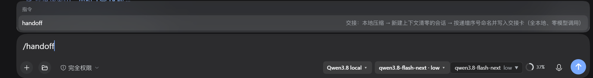

# 安装与使用指南 / Install & Usage Guide

[中文](#中文) · [English](#english)

---

## 中文

### 状态 / Status

**v0.2.0 · beta。** 核心流程（`/handoff` → 交接卡 → 新会话 → 自增命名 → 置顶）在作者的机器上长期在用；
跨环境安装路径（尤其是「装成 profile 包 + 浏览器半边」的 `childMode: none`）**尚未在第二台机器上验证**。
遇到问题请开 issue，带上「启动日志里 `/handoff registered` 打印了几次」这一条。

### 方式 A：下载即用（不需要 npm / pnpm）— 推荐给你我这样的单机用户

1. 把本仓库下载下来，整个目录放进你的 DSH profile 的 `local-plugins\` 下：

   ```
   <你的 profile 目录>\local-plugins\dsh-x-wide_handoff\
     index.js  naming.js  client.js  cordis.patch.yml  package.json ...
   ```

   - Windows 桌面版默认 profile：`C:\Users\<你>\.dsh\profiles\desktop\`
   - **目录名随意，但里面的 `package.json` 不能删**（缺 `name`/`version` 会让插件清单模块抛
     `must declare non-empty name and version`，表现为每次请求在发出前就失败）。

2. 在 profile 的 `cordis.patch.yml` 末尾加**一行**挂载：

   ```yaml
   - id: dsh-xwide-handoff
     name: './local-plugins/dsh-x-wide_handoff/index.js'
     config:
       enabled: true
   ```

3. **重启 DSH**（改 patch 不重启不生效）。启动日志应出现 `/handoff registered` **一次**。

4. 用法：在聊天输入框敲 `/handoff`，可带一句备注当「本次交接重点」：

   

   ```
   /handoff 接着做发布：先剥机器专属项，再 push
   ```

### 方式 B：装成 profile 包（市场/npm 路线）

```bash
# 在 DSH profile 目录里
pnpm add dsh-xwide-handoff
```

然后把包名 `dsh-xwide-handoff` 加进 profile `package.json` 的 `dsh.profile.bundles` 数组。
本包自带 `cordis.patch.yml`（`package.json` 的 `dsh.bundle.patch` 已声明），装载行由它自己插好，
**你不需要**再加 `- insert:`。

> ⚠️ **只能有一个装载实例。** bundles 里有一条、profile 补丁里又直装一条 = **两个实例**：
> 同名 `/handoff` 命令注册两次、自愈 watcher 挂两遍、扫描器跑双份。
> 现象：启动日志里 `/handoff registered` 打印两次。修法：二选一（保留带 `config:` 的那条）。

### 配置项 / Config

基线写在包自带的 `cordis.patch.yml`；设置页里改过的值会写进 `settings.yaml` 覆盖基线，清空即回落。

| 键 | 默认 | 说明 |
|---|---|---|
| `enabled` | `true` | 关掉 = 不注册命令、不挂 watcher（保留实例只为让旧会话能恢复） |
| `commandName` | `handoff` | 斜杠命令名 |
| `childMode` | `create` | `create` = 服务端直接建新会话（稳定）。`fork` = 继承历史。`none` = 交给浏览器半边建（列表即时可见，**跨机器未验证，见下方故障③**） |
| `titleTemplate` | `{base}_{seq}` | 新会话标题模板，**必须含 `{seq}`**；`{base}` = 源会话标题去掉已有序号 |
| `seqWidth` | `2` | 序号位数（`01`、`02`…） |
| `maxTitleChars` | `64` | 标题长度上限 |
| `recentUserMessages` | `6` | 卡片「最近你的原话」带几条 |
| `compact` | `false` | 交接时是否本地压缩。**本地大模型上保持 `false`**：对近满上下文做本地压缩在单卡上是分钟级，这就是「交接很慢」的根因；要压缩请用官方 `/compact` |
| `repinLimit` | `3` | 新会话被官方改名后最多重钉几次；`0` = 关自愈 |
| `autoReady` | `true` | 到阈值自动把新会话备好（建好/命名/置顶/注卡），**不替你切会话** |
| `readyPct` | `0.7` | 触发阈值 |
| `readyCooldownMs` | `600000` | 两次自动备好的最小间隔（10 分钟） |
| `contextWindow` | `262144` | **必须按你自己的模型窗口改**：默认值取自作者的本地模型。云端模型常见 128K，本地 llama.cpp 常见 262144。判占用用的是最近一次请求的 `usage.inputTokens ÷ contextWindow`（**不是**累计的 `totalTokens`） |

### 故障排查 / Troubleshooting

**① 启动日志里 `/handoff registered` 出现两次 → 双实例。**
原因：同一个 id 被挂载两次（bundles + profile 直装）。后果：命令重复注册、watcher 双份。
修法：只保留一处（带 `config:` 的那条），或从 `dsh.profile.bundles` 里摘掉包名。

**② 新会话打不开，报 `stored log is corrupt` / `system/message requires a protected first surface head`。**
原因：DSH 要求会话可见序列的第一条必须是 `system/message`；插件在建会话瞬间直接注入 `user/message` 会抢占首位。
本插件已修（先 append 一条形状合法的 `system/message` 占位，再注卡）。若你二次开发，**不要**去掉这一步。

**③ 侧栏整列表显示为空 / 历史交接被重放。**
出现在 `childMode: none` 且浏览器半边的去重只靠 `localStorage` 时：换 profile 写入路径后去重记录清空 →
历史交接结果里的旧 payload 被逐条重放，批量建会话+改名，UI 层炸穿（会话数据本体不丢）。
**回退 `childMode: create`** 即恢复显示。用 `none` 的前提：本包已装成 profile 包，且浏览器半边补上
「payload 落盘去重 + 只认本次 commandId + 不遍历历史」。

**④ `/handoff` 菜单里有、执行了，但没新建会话。**
按顺序查：启动日志有没有 `/handoff registered` → 有没有两个实例 → 改过 `cordis.patch.yml` 后**重启**了吗 →
`enabled: true` 吗 → 同 id 的 profile 层 config **不能**可靠覆盖包内基线（实测命令会被包内那个实例接走）。

**⑤ 恢复旧会话报 `RemoteError: <插件名> ... never started`。**
说明旧会话记录里存着一条已经不存在的插件挂载行。把那一行以 `enabled: false` 的形式挂回去
（实例起得来即可解析，不注册命令）就能恢复。

### 隐私 / Privacy

交接卡会写进新会话的第一句，内容包含你最近几条原话和改动过的文件路径 —— 它们留在**本机**的会话日志与
`handoff\` 目录里，本插件不联网、不调用任何模型、不上云。

---

## English

**v0.2.0 · beta.** The core flow (`/handoff` → card → new session → auto-numbered title → pin) is in daily use
on the author's machine; cross-machine install paths (especially `childMode: none`, which relies on the
browser half) are **not yet verified** on a second box.

**A. Download & drop (no npm)** — copy this repo into `<profile>\local-plugins\dsh-x-wide_handoff\`, add one
mount row to the profile's `cordis.patch.yml`, restart DSH, type `/handoff`.

```yaml
- id: dsh-xwide-handoff
  name: './local-plugins/dsh-x-wide_handoff/index.js'
  config:
    enabled: true
```

**B. As a profile bundle** — `pnpm add dsh-xwide-handoff`, then add `dsh-xwide-handoff` to
`dsh.profile.bundles` in the profile `package.json`. The package ships its own bundle patch, so do **not**
add an extra `- insert:` row: two mount instances = duplicate command registration and two watchers
(look for `/handoff registered` printed twice at boot).

Set `contextWindow` to **your** model's window; the shipped default (`262144`) comes from the author's local
model. Pressure is measured as `usage.inputTokens / contextWindow` of the last request, never cumulative
`totalTokens`. Keep `compact: false` on local models — compacting a near-full context locally takes minutes.

Troubleshooting: ① `/handoff registered` twice → duplicate mount; ② `stored log is corrupt` → the
protected first surface head was taken (see ② above); ③ empty sidebar / replayed handoffs → `childMode: none`
with localStorage-only dedupe, fall back to `create`; ④ command runs but no new session → check boot log,
duplicate instances, restart after patch edits, `enabled: true`; ⑤ restoring an old session throws
`never started` → re-add the stale plugin row with `enabled: false`.

No network, no model calls, nothing leaves your machine: cards land in the local session log and `handoff\`.
